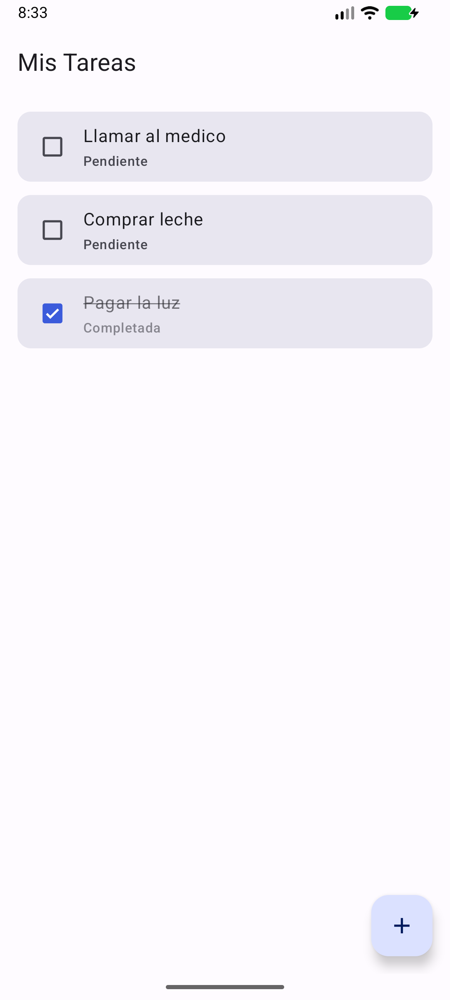
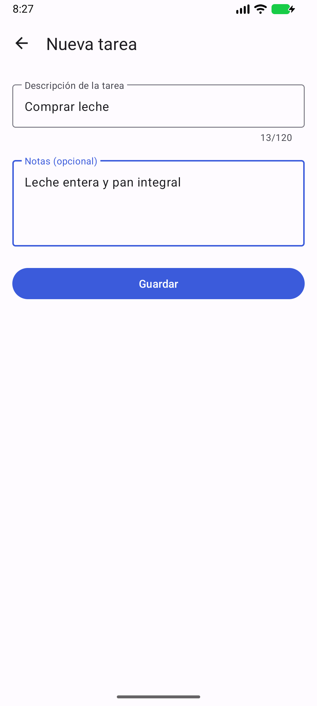
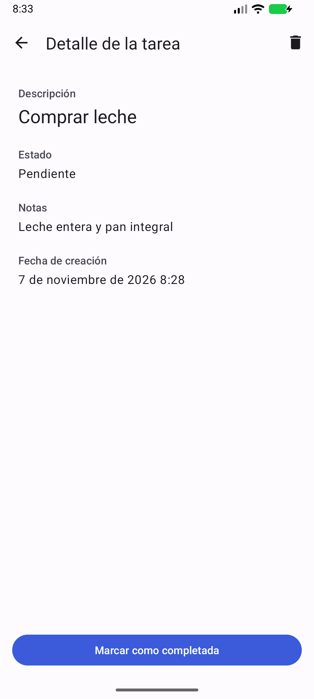
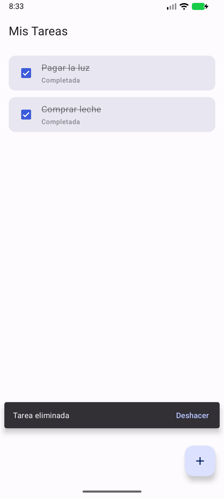

# Mis Tareas

App Android para anotar los pendientes del día **sin conexión a internet ni cuenta de usuario**.
Prototipo funcional hecho en Android Studio con Kotlin, vistas XML (Material 3) y Room.

<p align="center">
  
  
  
  
</p>

## Funcionalidades

| Requisito del enunciado | Cómo se resolvió |
| --- | --- |
| Pantalla principal con la lista (texto + estado) | `MainActivity` con un `RecyclerView`. Cada tarea muestra su descripción y si está *Pendiente* o *Completada*. |
| Botón para agregar que abre una segunda pantalla con un formulario | El botón flotante **+** abre `AddTaskActivity` (descripción obligatoria y notas opcionales). Al guardar vuelve a la lista y se desplaza a la tarea nueva. |
| Tocar una tarea abre una pantalla de detalle | `TaskDetailActivity` muestra descripción, estado, notas y fecha de creación. |
| Marcar como completada con cambio visual | Checkbox en cada tarea de la lista y botón en el detalle. La tarea se ve **tachada y atenuada**. |
| Eliminar una tarea | Deslizar la tarea en la lista (con aviso y **Deshacer**) o el icono de papelera en el detalle (con confirmación). |
| Persistencia aunque se cierre la app | Base de datos local **Room (SQLite)**. |

## Navegación y paso de datos

Hay 3 pantallas conectadas con **Intents explícitos**:

```
MainActivity ──(+)──────────► AddTaskActivity
     ▲                              │
     └──── setResult(id, texto) ────┘     Activity Result API

MainActivity ──(tocar tarea)──► TaskDetailActivity
              putExtra: id, descripción, notas, estado, fecha de creación
```

- **Lista → Detalle:** `TaskDetailActivity.newIntent(context, task)` arma el `Intent` con `putExtra`, y la
  pantalla de detalle lo lee con `getXxxExtra`. Las claves viven en `Extras`.
- **Agregar → Lista:** `AddTaskActivity` guarda la tarea, devuelve el id y la descripción con `setResult` y
  `MainActivity` los recibe con `registerForActivityResult` para mostrar el aviso y desplazar la lista.

## Persistencia

`Task` (entidad) → `TaskDao` (consultas) → `AppDatabase` (Room) → `TaskRepository`. Las pantallas solo
hablan con el repositorio, que expone las tareas como `Flow`: la lista se actualiza sola cada vez que cambia
la tabla, sin refrescos manuales. Las tareas se ordenan con las pendientes primero.

## Estructura

```
app/src/main/java/com/sebasmiumg/tareas/
├── TareasApp.kt              Application: crea el repositorio
├── data/
│   ├── Task.kt               Entidad Room
│   ├── TaskDao.kt            Consultas
│   ├── AppDatabase.kt        Base de datos
│   └── TaskRepository.kt     Único punto de acceso a datos
└── ui/
    ├── MainActivity.kt       Lista, swipe para eliminar, resultado de "agregar"
    ├── AddTaskActivity.kt    Formulario con validación
    ├── TaskDetailActivity.kt Detalle, completar y eliminar
    ├── TaskAdapter.kt        ListAdapter + DiffUtil
    ├── Extras.kt             Claves de los extras de los Intents
    ├── Insets.kt             Soporte edge-to-edge
    └── TextStyle.kt          Tachado de texto
```

## Tecnologías

- Kotlin, `minSdk 26`, `compileSdk / targetSdk 37`
- Android Gradle Plugin 9.4.1 y Gradle 9.6.0
- Material Components 1.13 (tema Material 3 claro/oscuro)
- Room 2.8.5 con KSP, corrutinas y `Flow`
- `RecyclerView` + `ListAdapter` + `DiffUtil`, ViewBinding

## Cómo ejecutarla

1. Abrir la carpeta del proyecto en **Android Studio** y esperar la sincronización de Gradle.
2. Elegir un emulador o un dispositivo y pulsar **Run**.

O por línea de comandos (JDK 17 o superior y el SDK de Android instalados):

```bash
./gradlew installDebug
```

## Historial

El proyecto se construyó con un commit por funcionalidad: proyecto base, persistencia con Room, lista con
`RecyclerView`, pantalla de agregar, pantalla de detalle, completar tarea y eliminar tarea.
